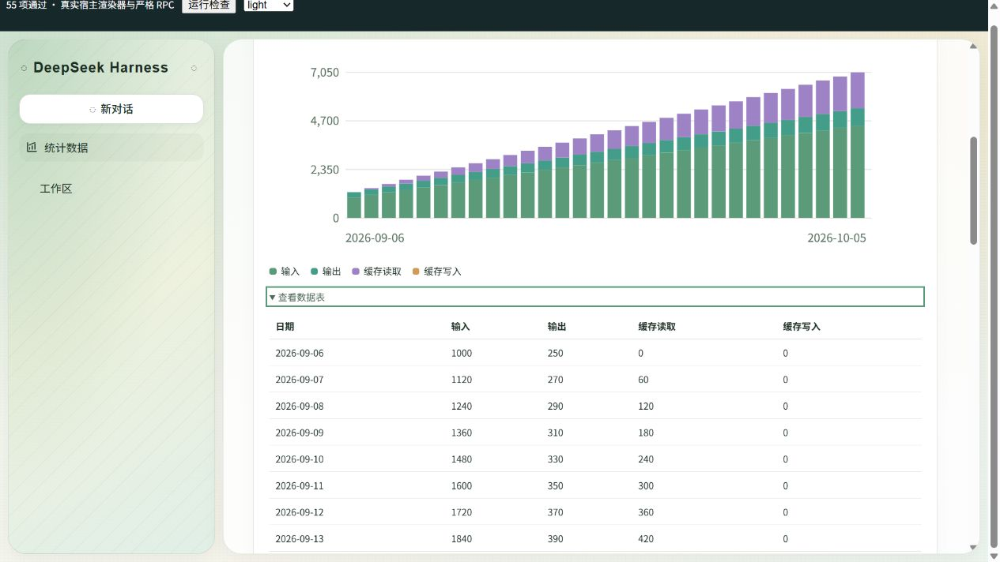

# DSH 使用统计

`dsh-usage` 0.1.1，以 DeepSeek Harness 0.2.1-rc.2 为兼容基线（SDK peers：`^0.2.1-rc.2`，Cordis：`~4.0.5`）。

0.1.1 更新官方 SDK 与桌面兼容声明，并适配新版网关的连接身份契约。统计域仍为 `dsh_usage`、格式版本仍为 1；直接读取并保留 0.1.0 的历史统计，无需清空或重新安装数据。

启用后，左侧“新对话”下方、工作区上方出现原生“统计数据”按钮。点击在主区域打开仪表盘；返回会话不会改变当前会话。采集运行在宿主，关闭统计页仍会持续记录。



## 图表与筛选

每日 token 趋势、模型用量排行、输入/输出/缓存构成、对话与调用趋势、最近十二周活动热力图、各模型记录耗时和失败率。日期默认近 30 天，支持今天、7 天、全部及自定义；同时支持工作区、提供方/模型和请求类型筛选。日期按浏览器本地时区计算。每张图都有可展开的数据表，支持键盘访问。

模型筛选作用于调用及 token；用户输入和 Agent 轮数按工作区、日期和请求类型统计，不强行归属于单一模型。导出 CSV 包含每日汇总；JSON 包含完整筛选汇总、模型数据、覆盖范围及状态，不包含原始对话。没有费用估算、账户账单和跨设备同步。

## 统计口径与覆盖范围

- 用户输入：`user/message` 中来源为用户的消息，不包含系统注入或未进入日志的 UI 操作。
- Agent 轮数：进入执行步骤的不同轮次。工具后续步骤仍属于同一轮。
- 模型调用：已结算的模型尝试；每次重试单独计数。成功、失败及取消分列。进行中的请求结算后显示。
- Token：适配器实际报告的 usage。输入、输出、缓存读取与写入互不重叠，推理 token 已包含在输出中，不再次累加。缺失 usage 显示“用量未知”。
- 耗时：存在请求阶段边界时计算到结算的记录耗时；缺少可靠边界的历史重试不填零、不计入平均耗时样本。辅助请求采用实际观察的流迭代时间。失败率分母包括成功、失败和取消的已结算调用。

启动先监听实时事件，再回填当前 profile 可读取的全部会话，包括归档及子 Agent；继承事件前缀不重复计算。无法读取的会话在页面报告。历史辅助请求没有完整用量日志，因此标题生成、压缩等从启用后采集；没有会话归属的辅助请求显示“未归属”。删除会话后已采集统计保留；插件首次启用前已删除的历史无法恢复。

## 存储与接口

统计使用宿主 `storageDomain`，域名 `dsh_usage`（宿主要求下划线），版本 1，采用 `per-record` 布局。保存时间、会话去重游标、工作区路径、提供方/模型、请求类别、状态、计数及耗时，不保存消息内容、工具输出、标题内容或密钥。存储位置及后端由宿主 profile 路由决定。

存储打开失败时使用最多 10,000 条内存统计记录，页面明确提示不持久化；内存记录超过上限会裁剪旧记录。写入失败时保留内存数据并重试，宿主模型请求不受影响。停用插件不会删除统计域。

宿主通过严格 Typert 描述提供 `dshUsage.query(filter)` / `dshUsage.export(filter, format)`；客户端先 `$mount`，再注入 `remote.dshUsage` 命名空间。使用现有网关，支持桌面与浏览器连接。客户端从宿主工厂加载共享 React，没有第二份 React 或图表库。

运行时 SDK 声明为 peerDependencies，同时保留固定版本的开发类型。桌面 profile 加载器据此将链接包的 SDK 导入路由到宿主的同一实例；尤其是 `dsh-llm` 的循环请求标记不能来自第二份模块，否则会把 Agent 调用重复计为辅助请求。

## 开发与安装

仓库根目录使用 pnpm 10.32.1：

```powershell
pnpm install --frozen-lockfile
pnpm --filter dsh-usage test
pnpm --filter dsh-usage run typecheck
pnpm --filter dsh-usage run build
pnpm --filter dsh-usage run test:browser
pnpm --filter dsh-usage exec pnpm pack --pack-destination C:\path\to\output
```

浏览器命令启动本地夹具，打开输出 URL 自动运行检查。它使用安装桌面版的 SlotRenderer、SidebarRoot、AppFrame、ThemePresenter、Client Remote 和真实 Host Gateway；样本数据为合成数据。完整 Electron 验证结果另见 VALIDATION.md。

DSH 安装应链接本包目录。profile 的 dependencies 和 bundles 增加 `dsh-usage`，启用记录为 `id: dsh-usage, disabled: false`。修改真实 profile 前退出 DSH 并备份 package.json、pnpm-lock.yaml、cordis.patch.yml。构建与打包由 prepack 保证产物存在。
